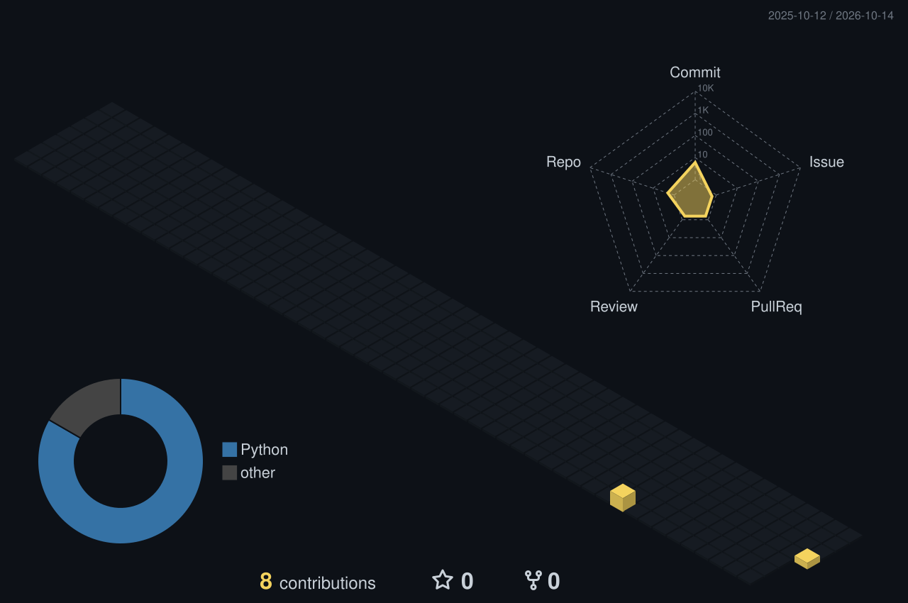

  

<h1 align="center">Khaled</h1>

  <code>Version 2026</code>

  Aspiring Entrepreneur &amp; AI/Data Engineer
   
  BSc (Hons) Software Engineering @ Sunway &amp; Lancaster University

  
  &nbsp;&nbsp;
  

<h2 align="center">Stack</h2>

  <strong>Languages</strong>

  

  <strong>Frameworks &amp; Databases</strong>

  

  <strong>Cloud &amp; Tools</strong>

  

  Also working with SQL · Oracle Database · Oracle APEX

<h2 align="center">Building Gotham</h2>

  

  The city needs me

